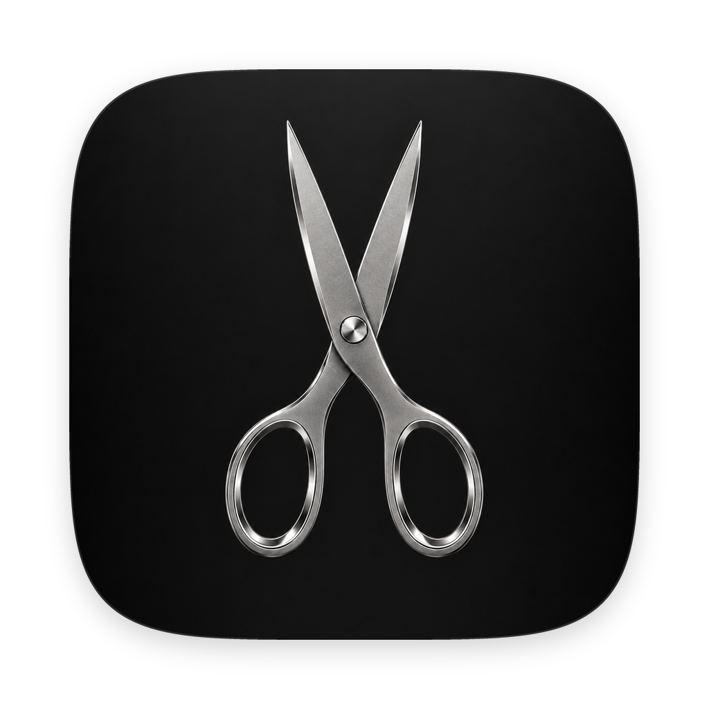
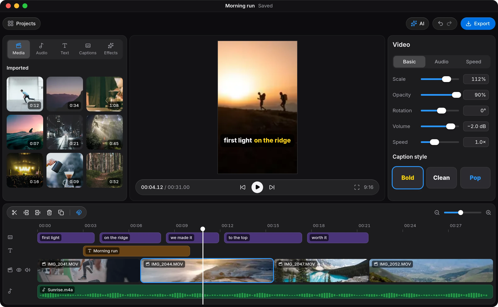

<p align="center">
  
</p>

<h1 align="center">Nuzky</h1>

<p align="center">
  A free, open-source video editor for your computer, in the spirit of CapCut.<br>
  <a href="https://nuzky.app">nuzky.app</a> · <a href="#install">Download</a> · <a href="#build-and-run">Build it</a> · <a href="CONTRIBUTING.md">Contribute</a>
</p>


<p align="center"><sub>The editor as drawn on nuzky.app. The alpha differs in places.</sub></p>

Cut a talking video by deleting words from its transcript, caption it with speech recognition that runs on your own machine, and let an AI agent do the tedious parts while you watch. Nuzky is licensed under GPLv3 and has a native Rust engine.

**Nuzky is in alpha.** It is early, so expect rough edges. Nuzky never changes or deletes your original videos. macOS works and is where Nuzky is tested. Linux is only partly tested. Windows isn't tested at all: the installer builds, but nobody has tried it on a Windows PC yet.

## What you can do

- Transcribe the timeline, then delete words or remove every pause straight from the text. Cuts land between words, and captions and overlays stay in sync.
- Generate captions with Whisper running on your computer. Voice detection keeps music and silence uncaptioned, and captions can highlight the word being spoken.
- Import footage straight from your phone. Rotated, mirrored and variable-frame-rate HEVC or H.264 clips cut on the exact frame. The canvas starts vertical (9:16), with 16:9, 1:1 and 4:5 a click away.
- Edit on a magnetic main track with overlay video, audio and text tracks. Move, trim, split and delete with snapping, undo and redo; Nuzky saves after every edit.
- Style text with an outline, a background box, size, colour, position, rotation and opacity.
- Export MP4 (H.264 and AAC) from the same renderer as the preview, so the file matches what you saw. Presets for Reels & TikTok, YouTube Shorts, YouTube 1080p and 4K, the Instagram feed and square posts write the platform's size with the sound levelled to −14 LUFS and true peak at most −1 dBTP.
- Let any MCP-capable AI agent edit the open project while you watch; each run undoes as one step. Connect agent sets up Claude Code, Codex and Gemini (Antigravity CLI) in one click, and the AI panel chats with your own Claude Code or Codex.
- Teach Nuzky a creator's style from raw recordings and their finished cuts, or from timelines they cut in another editor: CapCut drafts as they are, or exported as OpenTimelineIO (.otio), on Your style in the app or with `nuzky style learn`. It writes an `EDIT.md` that agents follow, takes the creator's own rules in plain words, and lets them talk the style through with the AI.

Nuzky itself sends nothing you edit anywhere. It goes online only to download models with a pinned checksum and, at most once a day, to read the latest version number from GitHub; you can turn that check off on the home screen. An AI agent you connect runs under your own account and sends what it reads to its provider.

## What the alpha doesn't do yet

- Intel Macs, Linux on ARM and Windows on ARM aren't supported.
- Export makes MP4 only. There is no template library and no phone app.

## Install

Download the installer for your system from [Releases](https://github.com/nuzkyapp/nuzky/releases). Apple has checked the macOS app. Nuzky has no Microsoft signing certificate yet, so Windows warns you the first time you open it.

- **macOS 14 or newer on Apple Silicon**, tested: open the `.dmg` and drag Nuzky to Applications. The first time you open it, macOS asks whether to open an app downloaded from the internet; click Open.
- **Windows 10 or 11, x64**, not tested at all: run the `-setup.exe`. When SmartScreen says "Windows protected your PC", click More info, then Run anyway. The installer downloads Microsoft WebView2 if it is missing.
- **Linux, x86_64**, partly tested: on Ubuntu 24.04 or newer, `sudo apt install ./Nuzky_*.deb`. On other distributions with glibc 2.39 or newer, make the `.AppImage` executable with `chmod +x` and run it.

The first captions or transcript download the speech model once. Nuzky tells you when a newer version is out and downloads it when you click Update, then installs it when you click Restart to update.

## Report a bug

In Nuzky, open Send feedback (the speech bubble next to Projects, or at the bottom of the home screen's sidebar) and choose Report a bug…. It opens the bug report form on GitHub with your version and system filled in and copies the diagnostics for you to paste into it: the version, system, graphics and the end of Nuzky's log, without folder names, typed text or secrets. Nothing is sent until you submit the form. Copy diagnostics and Open logs folder in the same menu give you the same information again. After a crash, the next start offers Report a bug… as well.

Say what you did and what happened, and please don't attach a private video. No GitHub account? Write to [@mach_builds](https://x.com/mach_builds) on X. Report security problems privately, as [SECURITY.md](SECURITY.md) describes.

## Build and run

You need current stable Rust (at least 1.94), Node 22.12+, FFmpeg shared libraries with headers, clang (for bindgen) and cmake (for whisper.cpp). Linux also needs ALSA headers and WebKitGTK 4.1. [docs/BUILDING.md](docs/BUILDING.md) lists the exact dependencies for each system, the installers and the runtime libraries.

On Fedora or Nobara:

```sh
sudo dnf install ffmpeg-free-devel alsa-lib-devel clang cmake webkit2gtk4.1-devel \
  vulkan-loader-devel vulkan-headers glslc
npm install
npm run tauri dev
```

Without root on Fedora/Nobara, `bash scripts/setup-linux-deps.sh` downloads the FFmpeg and ALSA headers into `~/.cache/nuzky/deps` and writes a local `.cargo/config.toml`. The corresponding runtime libraries and WebKitGTK must already be installed. Install cmake with `pip install --user cmake` and put `~/.local/bin` on `PATH`.

On Ubuntu, `bash scripts/setup-ubuntu-deps.sh` installs the packages CI uses. For macOS and Windows, install the dependencies from [BUILDING.md](docs/BUILDING.md) and run the same npm commands. Pushing a matching `v*` version tag builds installers on all three systems and prepares a draft GitHub Release; the macOS build is signed with a Developer ID and notarized, the Windows installer is unsigned, and a system nobody tested on is marked untested in the release notes.

`npm run tauri dev` opens your own projects. To work on Nuzky without touching them, run it as [CONTRIBUTING.md](CONTRIBUTING.md) describes.

## Command line

```sh
cargo run -p nuzky-cli -- probe clip.mov
cargo run -p nuzky-cli -- new project.nuzky a.mp4 b.mov
cargo run -p nuzky-cli -- frame project.nuzky 2.5 frame.png 540
cargo run -p nuzky-cli -- render project.nuzky out.mp4
cargo run -p nuzky-cli -- render project.nuzky reel.mp4 --preset reels
cargo run -p nuzky-cli -- render project.nuzky video.mp4 --preset youtube_1080p
cargo run -p nuzky-cli -- style learn raw.mov reel.mp4 raw2.mov reel2.mp4
cargo run -p nuzky-cli -- style learn --from reel.otio --from reel2.otio
cargo run -p nuzky-cli -- style learn --from "$HOME/Movies/CapCut/User Data/Projects/com.lveditor.draft/0928"
cargo run -p nuzky-cli -- style compare raw.mov reel.mp4 project.nuzky
```

Projects are JSON files, so the same project renders identically in the app and on a server.

`style learn` writes the creator's `EDIT.md` into Nuzky's data folder (`--out` elsewhere, `--replace` to overwrite an existing one) from pairs of a raw recording and the finished cut made from it, or with `--from` from OpenTimelineIO timelines cut in another editor, whose recordings must be on this computer. `style compare` prints how much of the creator's cut a project keeps, word by word (recall and precision). Both recognise speech locally and nothing leaves the computer.

## How it works

```
crates/engine   project model, edits + undo, FFmpeg decoding, wgpu compositor,
                text rendering, audio mixing, MP4 export
crates/analysis local speech recognition, caption grouping, silence and scene analysis,
                learning a creator's style from their finished cuts
crates/vision   local face and subject models: frames worth a cover, where the person is
crates/session  editing authority, undo runs, autosave, crash recovery and transcripts
crates/mcp      agent tools, stdio bridge and live-app IPC
crates/agent    runs the user's own Claude Code or Codex for the in-app AI panel
crates/cli      `nuzky` headless CLI and MCP entry point
src-tauri       desktop shell: preview thread, audio output, background jobs, session events
src             React + TypeScript UI
```

Dependencies point one way. `engine` uses no other Nuzky crate, `analysis`, `vision` and `session` build on it, `mcp` builds on those four, and the CLI and the desktop app sit on top. `agent` stands alone; only the desktop app uses it.

- The engine renders every frame offscreen with wgpu. The preview streams those frames to the webview over a loopback WebSocket that only accepts the app's own origin and a per-launch secret. Export reuses the same renderer at full resolution.
- Each video clip decodes on its own thread with exact seeking on real timestamps, so cuts and variable frame rates stay frame accurate.
- Audio of each file is decoded once into a 48 kHz cache. Playback, export and captions all mix from it. Waveform peaks are written beside it while it decodes, and the timeline loads them in blocks around what is on screen.
- The Rust side owns the project. The UI sends edit commands and receives the new project back, and AI agents and the CLI go through the same editing authority.

More detail: [docs/INTERACTION.md](docs/INTERACTION.md) (behaviour), [DESIGN.md](DESIGN.md) (look), [docs/AI-ARCHITECTURE.md](docs/AI-ARCHITECTURE.md) (agents).

## Contributing

Nuzky is young, so a bug report helps as much as a pull request. When something breaks on a clip from your phone, open an issue with the phone, the app it was recorded in and what you did; please do not attach a private video. [CONTRIBUTING.md](CONTRIBUTING.md) explains how to set up a checkout, test your change and send a pull request, and [AGENTS.md](AGENTS.md) holds the rules for code changes, for people and coding agents alike. Report security problems privately, as [SECURITY.md](SECURITY.md) describes.

## License

GPL-3.0-or-later. FFmpeg with x264 is GPL and compatible with this licence. The export uses FFmpeg's native AAC encoder because `libfdk_aac` is not GPL compatible. The sound effects and songs built into Nuzky are CC0 1.0; `assets/sounds/manifest.json` lists their authors and sources. The sample video of the tour for new users is a minute of a video by Dianne Glavaš under CC BY 3.0; `assets/sample/ATTRIBUTION.txt` credits it, and [docs/BUILDING.md](docs/BUILDING.md#bundled-sample-video) says how it is made. The emoji are Google's Noto Emoji (Apache-2.0, flags public domain) with names from Unicode CLDR (Unicode License v3), and Nuzky's own stickers are CC0 1.0; `assets/stickers/catalog.json` lists their sources, and [docs/BUILDING.md](docs/BUILDING.md#bundled-emoji-and-stickers) says how they are built.
